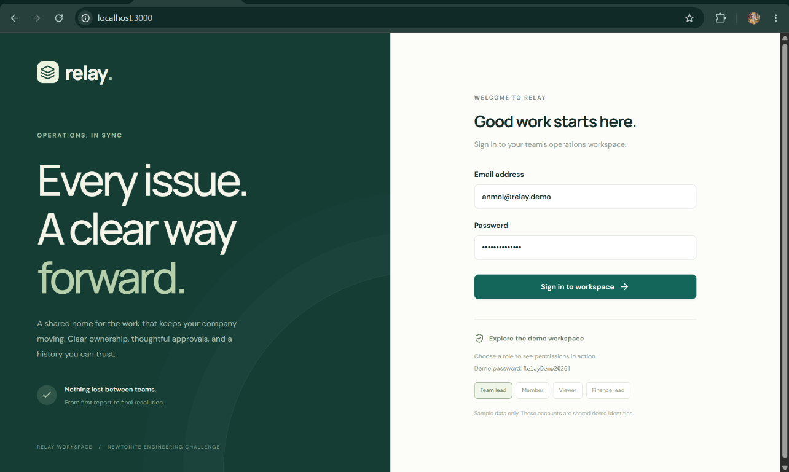
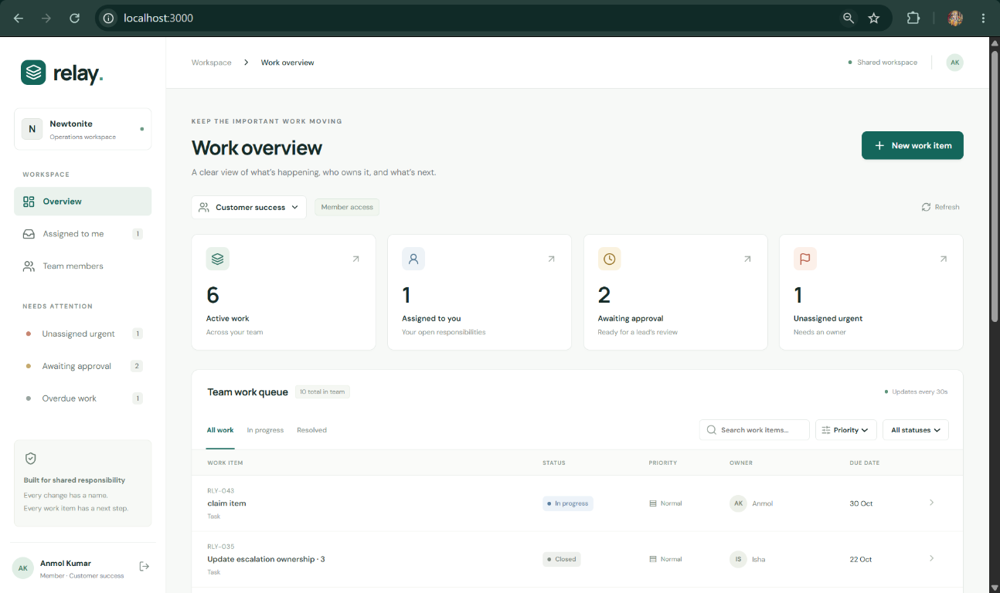

# Engineering decisions

These decisions explain the actual implementation, including where it takes shortcuts. They should be reviewed and defended by the candidate, rather than treated as a script to memorize.

## Product snapshots

The product intentionally presents a simple operating view that keeps work movement, ownership, and approval stages visible at a glance.

### Login screen

### Work overview

## 1. One application service, two database adapters

**Context.** The reviewer needs a simple local run, and the project also needs a working hosted version. Provisioning Redis and a separate database would add setup work before the reviewer can exercise the important behaviour.

**Options.** A PostgreSQL API; an in-memory prototype; or a SQLite-compatible service with local and hosted adapters.

**Choice.** React calls one request handler. Local Node uses SQLite; the hosted Worker uses D1. Both execute parameterized SQL from the same application service. Node 24's built-in SQLite avoids a native npm driver dependency. Docker provides persistent storage with a named volume.

**Trade-off.** This is easy to run and inspect, but SQLite serializes writes. The schema and bounded queries support growing datasets; that does not prove throughput for thousands of concurrent users. At sustained write pressure, move to PostgreSQL, preserve compare-and-swap updates, and replace SQLite triggers/migrations with PostgreSQL equivalents. Do not scale the portable server across independent hosts sharing an unsafe database file.

## 2. A workflow with explicit responsibility and a lead approval boundary

**Context.** Requests can change owners and may require approval. The brief does not define roles or state names.

**Options.** Free-form status labels; a fixed workflow; or a configurable workflow engine.

**Choice.** Open → In progress → Review → Resolved → Closed. A member claims responsibility before progressing work. A lead approves Review → Resolved, may reject it back to In progress, closes resolved work and reopens it. There are three roles per team. One user's role can differ across teams. Work-item team cannot be changed after creation in this version.

**Trade-off.** Every item uses an approval step, even a small task. This is deliberately stricter than necessary, but easy to explain and test. Product validation should determine which categories can skip approval. A configurable engine would be premature for a one-day assessment.

**Failure boundary.** Every detail, activity, list and write request checks membership on the server. Hidden UI controls are only a convenience. A lead from Finance cannot read or approve an Engineering item.

## 3. Compare-and-swap updates instead of a read-then-write assumption

**Context.** Two people can view version 1, then both try to claim or edit it. A previous read is not a lock.

**Options.** Last-write-wins; pessimistic locks; or versioned conditional updates.

**Choice.** Writes include the observed version. SQL updates use `WHERE id = ? AND version = ?`, incrementing the version on success. Claims also require `assignee IS NULL`. A failed conditional update returns 409 with the latest state. The frontend offers a reload action and retains the user's visible version rather than quietly overwriting it.

**Trade-off.** Users must reload and reapply conflicting edits. This protects correctness but provides no field-level merge. Independent edits to different fields can conflict. At this scope, that is preferable to accidentally losing one person's work.

**Proof.** Two competing claim requests yield one successful response and one conflict. Stale edits leave the newer stored priority unchanged. The tests use real SQL and interleaved requests, not a mocked repository.

## 4. Keep history in the same transaction; deduplicate creates at the database boundary

**Context.** Writing a work item and then separately writing its audit history can leave the two inconsistent. Request retries can also create duplicate work.

**Options.** Application-only sequential writes; explicit multi-statement transactions; or database triggers plus a unique creation key.

**Choice.** SQL triggers append events for every work-item insert or update. Because the trigger runs in the item's transaction, an audit failure rolls back the item update. Actor and change description are supplied by the authenticated handler. Update/delete triggers reject edits to activity rows. Create requests carry a per-user idempotency key with a hash of the normalized payload. A unique index arbitrates concurrent duplicate inserts; a changed payload with the same key conflicts.

**Trade-off.** Some behaviour lives in SQL, so migration review matters. A database administrator can still alter triggers; append-only is an application/database constraint, not cryptographic tamper evidence. Creation keys are retained with items. Replays return the current item instead of preserving a snapshot of the original response. Comments are not deduplicated.

**Proof.** The test suite deliberately forces the history trigger to fail and confirms that both item version and priority remain unchanged. Duplicate creates yield one item and one creation event.

## 5. Bounded reads and server-confirmed UI; defer optional background work

**Context.** An overview must remain useful with many work items. Loading all records into the browser is not acceptable. Notifications would introduce a separate failure/retry lifecycle.

**Options.** Client-side filtering with complete datasets; offset pagination; or keyset pagination and server filtering. Optimistic UI and background queues were also considered.

**Choice.** Team-scoped SQL filters, ID-based cursor pagination, 20 rows per work-item page and 30 events per history page. Team/status, team/priority and team/assignee indexes cover common access paths. Dashboard aggregates are computed server-side. Mutations wait for the server response; list polling runs every 30 seconds. No asynchronous worker is included.

**Trade-off.** Contains search still scans part of a team's dataset; polling is not real time. Aggregates can become expensive. Notifications are absent, not silently unreliable. A next iteration would add full-text search and measure query plans before introducing infrastructure. If notifications become required, use an outbox committed with the item mutation, an idempotent consumer, bounded retry/backoff and a dead-letter view.
