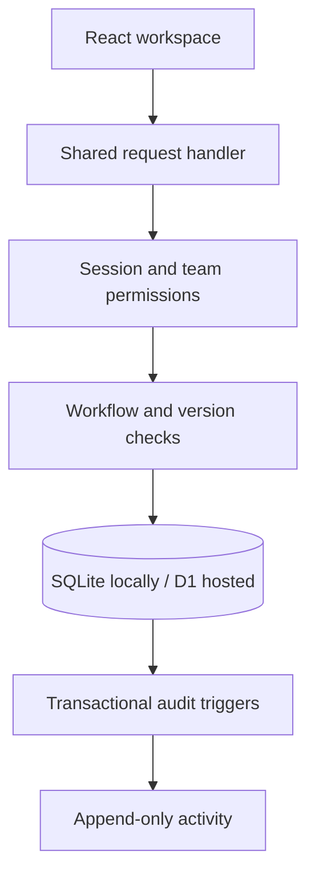

# Relay — Operations Under Pressure

Relay is an internal workspace for teams handling incidents, customer issues, payments, compliance requests and operational tasks. It makes ownership explicit, routes work through a lead-approved workflow, and records changes without losing history when users collide.

Built for the Newtonite Software Engineering Challenge. The application implementation and documentation were developed for this brief with AI assistance. See [ORIGINALITY.md](ORIGINALITY.md) for provenance and [ENGINEERING_DECISIONS.md](ENGINEERING_DECISIONS.md) for trade-offs.

## Run in two minutes

### Option A: Docker Desktop

Install Docker with Compose, extract this project, and run:

```sh
docker compose up --build -d
```

Open **http://localhost:3000**. The database is migrated and populated automatically. The `relay-data` volume persists changes across restarts.

```sh
docker compose logs -f relay
docker compose down
```

`docker compose down -v` permanently deletes the demo database. Do this only when you intentionally want a fresh dataset.

### Option B: Node.js (Windows, Linux or macOS)

Use **Node.js 24**. The included portable frontend build means the first run needs no package installation:

```sh
node server/local.mjs
```

Open **http://localhost:3000**. Local data lives in `data/relay.sqlite`, which is ignored by Git. The server uses Node's built-in HTTP and SQLite modules; it has no runtime npm dependencies.

To edit and rebuild the frontend, install dependencies and build:

```sh
corepack enable
corepack prepare pnpm@11.25.0 --activate
pnpm install --frozen-lockfile
npm run build:local
npm run start:local
```

If Corepack is unavailable, install the exact package manager with `npm install -g pnpm@11.25.0`. The checked-in lockfile pins dependency resolution. Stop and restart the server after backend edits. Rebuild after frontend edits.

Optional environment variables: `PORT` (default `3000`) and `DATA_DIR` (default `./data`). `.env.example` documents these; the portable server reads process environment variables, not an automatically loaded `.env` file. For PowerShell: `$env:PORT="3001"; node server/local.mjs`.

## Demo accounts

Every demo account uses **`RelayDemo2026!`**. These are intentionally public evaluation credentials, not production secrets.

| Email | Team roles |
|---|---|
| anmol@relay.demo | Engineering Lead; Customer success Member |
| maya@relay.demo | Engineering Member |
| arjun@relay.demo | Engineering Member |
| isha@relay.demo | Engineering Viewer; Customer success Lead |
| kabir@relay.demo | Finance Lead |
| noor@relay.demo | Finance Member |

The first run includes three teams, six users and 42 work items. Switch teams from the dashboard. Use separate browser profiles for simultaneous users, or duplicate tabs for stale edits. Cookies are shared between tabs in the same profile.

## What is implemented

- Team-scoped membership with Viewer, Member and Lead roles.
- Password authentication, opaque expiring sessions and HttpOnly / SameSite cookies.
- Work-item creation, details, edits, due dates, priorities and categories.
- Atomic self-claim and lead-controlled reassignment.
- Workflow: **Open → In progress → Review → Resolved → Closed**.
- Lead-only approval, rejection to In progress, and reopening.
- Append-only change history and comments, including actor and timestamps.
- Attention views: assigned to me, unassigned urgent, awaiting approval and overdue.
- Server-side search, filtering and cursor pagination; 20 items per page, 30 history events per page.
- Explicit conflict feedback with a reload action. The detail remains on its known version until refreshed; background list polling never overwrites an unsaved edit.
- Responsive React interface and a 30-second list refresh.

### Permission matrix

All permissions are scoped to the item's team; a lead in another team has no access.

| Action | Viewer | Member | Lead |
|---|---|---|---|
| List / read / history | Yes | Yes | Yes |
| Create / comment | No | Yes | Yes |
| Claim unassigned active item | No | Yes | Yes |
| Edit details | No | Own assigned item | Any non-closed item |
| Change owner | No | No | Eligible member of same team |
| Open → In progress → Review | No | Own assigned item | Any assigned item |
| Approve / reject / close / reopen | No | No | Yes |

A workflow cannot progress without an owner. Closed items must be reopened before editing. Comments remain available on closed items to preserve follow-up context. No delete endpoint exists.

## Test the dangerous behaviours

No npm installation is needed for the API tests:

```sh
node --test tests/*.test.mjs
```

Or `npm test`. Twelve API-level tests cover simultaneous claims, stale writes, retry-safe creates, role enforcement, cross-team access, workflow rules, invalid assignees, transactional history rollback, immutable activity, pagination during inserts, input validation, comments and login protections.

The tests call the real request handler and run real SQL against temporary in-memory SQLite databases. They are not mocked database assertions. The concurrency tests interleave requests with `Promise.all`; SQLite serializes the writes. They do not simulate multiple machines or benchmark hundreds of users.

### Larger dataset

Stop the portable server, then run:

```sh
node server/seed-large.mjs 10000
node server/local.mjs
```

The synthetic seed is repeatable without duplicating the same load-test rows. This checks pagination and query behaviour; it is not a throughput benchmark.

## Architecture



The portable server and the separately hosted version both use `lib/core.mjs`. This archive is the portable submission; deployment-only starter infrastructure is omitted. `server/sqlite.mjs` implements the small D1 query interface with Node's SQLite library. Hosted persistence uses a D1 binding; local persistence uses a SQLite file. The two deployment environments have separate data.

| Path | Purpose |
|---|---|
| `app/page.tsx` | Dashboard, login, item detail, create/edit forms and activity UI |
| `app/globals.css` | Responsive visual system |
| `lib/core.mjs` | Request validation, authentication, permissions and application rules |
| `db/schema.ts` | Drizzle schema definitions |
| `drizzle/*.sql` | Schema, indexes and transactional audit triggers |
| `server/local.mjs` | Portable HTTP/API/static-file server |
| `server/sqlite.mjs` | SQLite adapter and ordered migrations |
| `frontend/` | Portable frontend entrypoint |
| `tests/api.test.mjs` | Risk-focused API tests |
| `dist-local/` | Built portable frontend, included in the source delivery for immediate use |

Database tables: users, teams, memberships, sessions, login_attempts, items and events. Creation keys are unique per user. Item updates are conditional on the expected version. Every insert/update writes history through an SQL trigger in the same transaction.

## API summary

All mutations accept JSON. Authentication uses the session cookie. Errors return `{ "error": "message" }`; conflicts may additionally include `latest`. Server errors do not expose SQL internals.

| Method | Endpoint | Notes |
|---|---|---|
| POST | `/api/login` | email, password |
| POST | `/api/logout` | Revoke session |
| GET | `/api/me` | User and memberships |
| GET | `/api/members?team=engineering` | Authorized team members |
| GET | `/api/items?team=engineering` | Optional q, status, priority, view, cursor |
| POST | `/api/items` | Header `Idempotency-Key`; title, description, type, priority, team_id, due |
| GET | `/api/items/:id` | Authorized detail |
| PATCH | `/api/items/:id` | version plus editable fields |
| POST | `/api/items/:id/claim` | version |
| POST | `/api/items/:id/transition` | version, status |
| GET | `/api/items/:id/activity` | Optional cursor |
| POST | `/api/items/:id/comments` | body |

## Known limitations

- Evaluation accounts have shared known passwords. There is no sign-up, password reset, SSO, account administration or session management screen. Replace demo identities before any real deployment.
- First-login hosted seeding uses separate user/team and item batches. If item seeding fails after the first batch, an administrator must repair sample data; no automatic reset endpoint is exposed.
- Async notifications, attachments, external integrations and websocket delivery are intentionally excluded. The company brief makes asynchronous work optional.
- Contains search uses escaped LIKE predicates scoped to a team. It is bounded in output but may scan matching team records. Full-text search and precomputed dashboard counters would be needed at materially larger scale.
- SQLite is a single-writer database. D1 provides managed persistence but is not a claim of PostgreSQL-like write concurrency or proven high-load throughput. Multi-instance portable deployment requires a different database strategy; do not mount the file into independent hosts.
- Cursor pagination is stable by immutable ID, not an exact snapshot of changing filter membership. Newly created items appear when returning to the first page.
- Idempotency keys apply to creates. A repeat returns the same item's current representation, not a frozen original response. Version checks protect other mutations; comments may duplicate after an uncertain network failure.
- Login throttling is per email for ten minutes; there is no perimeter/IP rate limiter. Expired sessions are removed on login, but login-attempt rows are not periodically pruned.
- Due dates and overdue checks use UTC. No timezone-specific SLA scheduler is included.
- The interface uses conservative server-confirmed mutations, not optimistic updates. Activity requires reopening/reloading the detail to see other users' new comments.
- Modal dialogs have accessible labels, Escape dismissal and initial focus. Full screen-reader and keyboard interaction auditing has not been completed.
- Font loading uses Google Fonts with local sans-serif fallbacks. Offline functionality does not depend on the fonts.
- Hosting build, portable build, TypeScript and automated API checks were run. Browser automation and Docker execution were unavailable in the build environment; manually verify the UI and Docker on your machine before submitting. A fresh dependency install could not be verified because the offline package mirror was incomplete. The portable build was verified with the installed dependency set, and the bundled build requires no installation to run.

## Before submission

1. Run the app and the tests on your machine.
2. Follow [DEMO_WALKTHROUGH.md](DEMO_WALKTHROUGH.md), including the two-tab stale-edit demonstration.
3. Read every engineering decision and change assumptions if you disagree with them.
4. Create your GitHub repository (suggested name: `newtonite-ops-23scse1011799`) and push the source. Do not commit `data/`, `.env`, `node_modules/`, runtime credentials or deployment-only access tokens.
5. Include the repository link, decisions, limitations and optional demo video in the university submission form. This project has not been submitted on your behalf.

The university advisory states **19 October 2026, 10:00 AM IST** as the submission deadline. Its stack and workflow suggestions are advisory; the company brief is the source of required behaviour.
